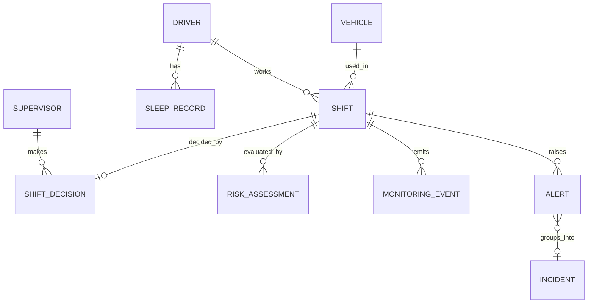

# Data Flow

| Data | Producer | Path | Stored | Sensitivity |
|---|---|---|---|---|
| Sleep records | Simulator/manual/import (`dataOrigin`) | → API `/v1/drivers/{id}/sleep-records` | PostgreSQL | Health (sensitive) |
| Risk assessments | API (derived) | API → DB → Dashboard | PostgreSQL | Derived health |
| Camera frames | Camera | Monitor memory only | **Never stored/sent** | Biometric-adjacent |
| Monitoring events | Monitor | → API `/v1/shifts/{id}/events` | PostgreSQL | Low–medium |
| Telemetry | Vehicle/simulator | → Monitor → events | via events | Low |
| Alerts/incidents | API | DB → SSE/REST → Dashboard | PostgreSQL | Medium |

## Identity and ordering
- IDs are UUIDs. `eventId` (monitor-generated UUID) is the idempotency key for events;
  `sourceRecordId` is the key for sleep records.
- `sequence` is monotonic per shift for ordering/gap detection.
- All timestamps UTC (RFC 3339). Device clock skew is possible; server stores `receivedAt` too.

## Minimum MVP schema [PROPOSED]
Tables introduced only by the OpenSpec change that needs them. Expected first set:
`drivers`, `vehicles`, `supervisors`, `sleep_records`, `shifts`, `risk_assessments`,
`shift_decisions`, `monitoring_events`, `alerts`, `incidents`. Every row that may be simulated has
`data_origin`. Deferred: companies/tenancy, users/auth tables, telemetry time series.

## Domain model

Responsibilities: **Driver** person profile (minimal). **Supervisor** acts on shifts/alerts.
**Vehicle** asset used in a shift. **Shift** lifecycle owner ([shift-lifecycle](../domain/shift-lifecycle.md)).
**SleepRecord** one wearable-derived period. **RiskAssessment** immutable result of one computation.
**MonitoringEvent** immutable observation from the monitor. **Alert** notification-worthy condition.
**Incident** supervisor-reviewable record grouping alerts, with acknowledgment.
