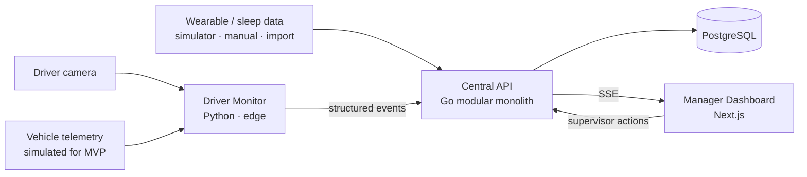
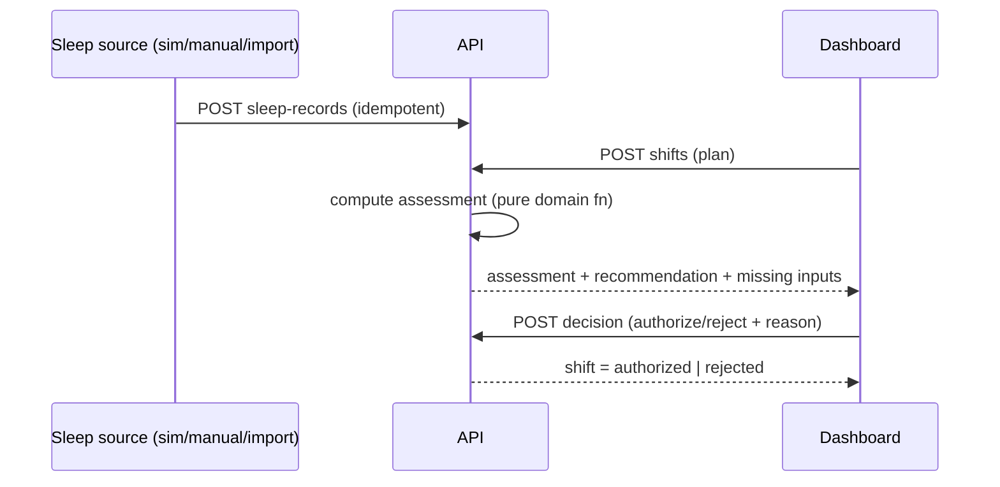
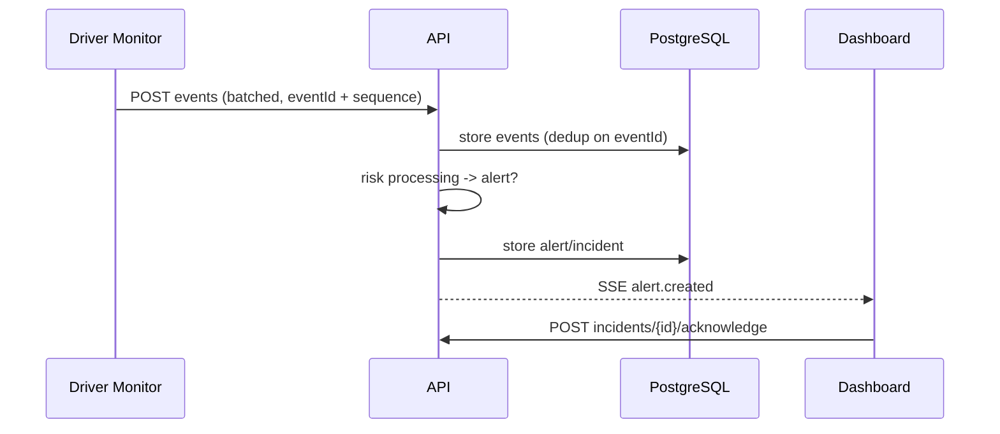

# Architecture Overview

Three independently deployable apps in one monorepo, plus PostgreSQL. Decisions are recorded as ADRs in
[adr/](adr/). Statuses: see [prd.md](../product/prd.md).

## Components and ownership
| Component | Owns | Does NOT |
|---|---|---|
| Driver Monitor (`apps/driver-monitor`) | Camera processing, landmarks, indicators, telemetry adapter, local driver alerts, event generation | Decide risk, authorize shifts, send video |
| API (`apps/api`) | Business decisions: risk assessment, shift states, alerts, incidents, persistence, idempotency | Run computer vision |
| Dashboard (`apps/dashboard`) | Presentation, supervisor actions | Hold business rules |
| Contracts (`contracts/`) | Source of truth for HTTP and event shapes | — |

## API internal structure (modular monolith)
`apps/api/internal/<domain>/` for drivers, shifts, wearables, assessments, monitoring, alerts,
incidents; each separates transport handlers, domain logic (no `net/http`/`pgx` imports), and
persistence. `integrations/` holds adapters to external sources (wearable providers). `platform/`
holds router, DB pool, shared helpers. Cross-domain calls go through small interfaces.

## Flow A — before a shift

## Flow B — during a shift

## Failure behavior [PROPOSED]
| Situation | Behavior |
|---|---|
| Wearable data unavailable | Assessment is `insufficient_data` with `missingInputs`; recommendation `review`. Never defaults to "safe". |
| Telemetry unavailable | Monitor emits `telemetry_unavailable`; camera pipeline continues; backend marks speed-dependent rules as not evaluated. Absent speed is never treated as 0. |
| Camera unavailable | Monitor emits `camera_unavailable`, alerts locally, and the backend raises a supervisor-visible alert (loss of monitoring is itself a risk signal). |
| Backend unreachable | Monitor keeps local alerts running and buffers events in a bounded in-memory/disk queue, then retries with backoff, preserving `sequence`. Overflow drops oldest heartbeats first, never alert-class events. |
| Duplicate event delivery | Ingestion is idempotent on `eventId`; duplicates are counted, not re-processed, and produce no extra alerts. |
| Out-of-order events | Ordered by `sequence` per shift; `occurredAt` is informational. Gaps are recorded. |

## Constraints
No Kafka, Redis, Kubernetes, or microservices. SSE for server→dashboard push. Timestamps UTC.
Simulation mode must be reproducible from public URLs (see [demo](../operations/demo.md)).
