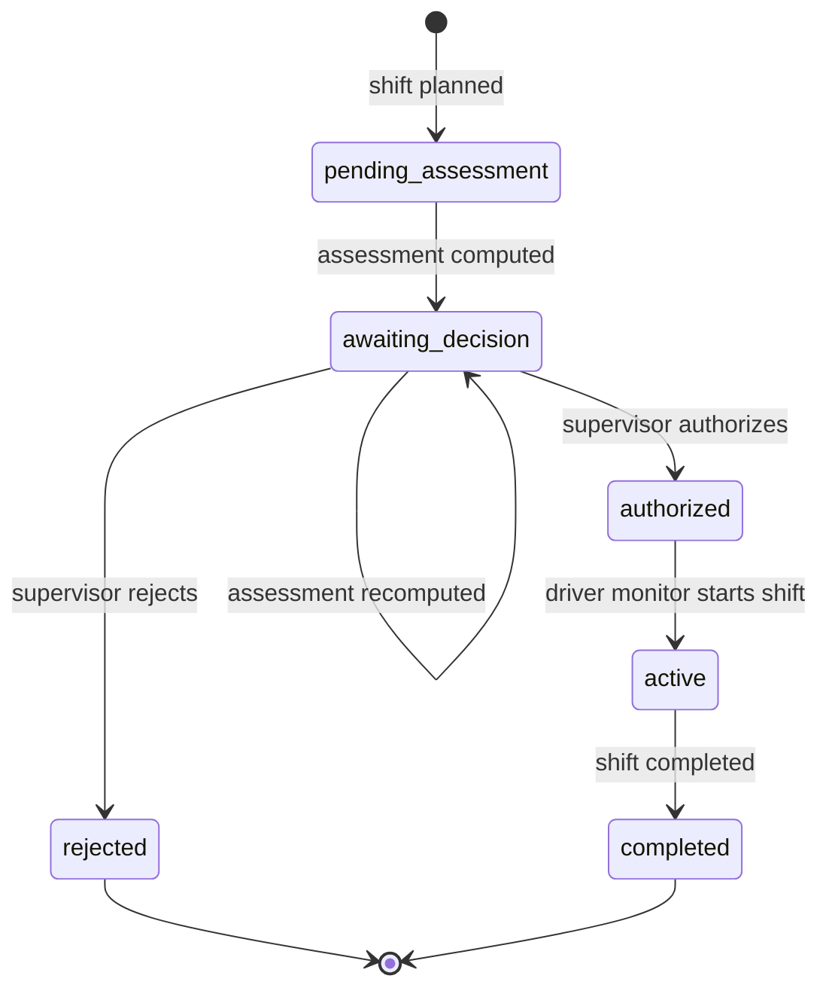

# Shift Lifecycle

States: `pending_assessment`, `awaiting_decision`, `authorized`, `rejected`, `active`, `completed`.

## Valid transitions
| From | Event | To |
|---|---|---|
| (new) | plan shift | pending_assessment |
| pending_assessment | assessment computed | awaiting_decision |
| awaiting_decision | supervisor authorize | authorized |
| awaiting_decision | supervisor reject | rejected |
| authorized | start | active |
| active | complete | completed |

## Invalid transitions (API returns 409 `invalid_transition`)
Anything else, notably: deciding before an assessment exists; starting a shift that is not
`authorized`; re-deciding a decided shift; reopening `rejected`/`completed`; completing a shift that
is not `active`. Monitoring events for a shift that is not `active` are rejected.

## Rules
- Only a supervisor decision authorizes; the assessment never authorizes automatically.
- Overriding a `withhold` recommendation requires a recorded reason.
- Every transition records actor, UTC time and (for decisions) reason. **[OPEN]** cancellation/expiry
  of authorizations not defined yet.
